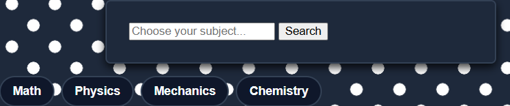
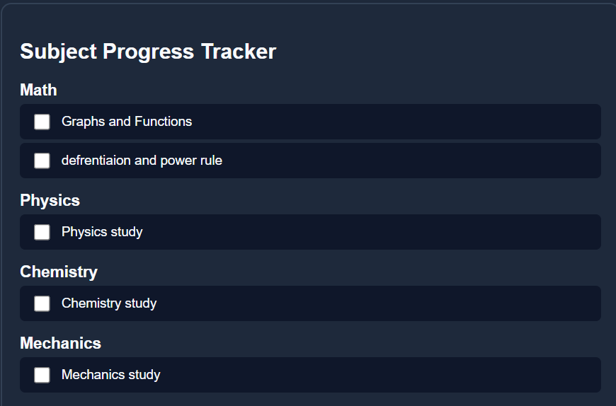
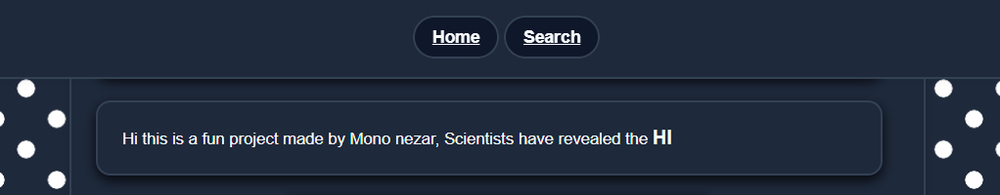
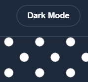

# The Absolute Study Helper✏️📚

## A fully functional webpage where you can checkout useful study notes for STEM students and track study time.

This project was built as a fun project to which aimed to provide students with a way to see notes for specific subjects (Math-Mechanics-Chemistry-Physics) and help them with their study using text and image notes.
## Features
* **Subject Search**: search through subjects by typing their names in the search bar and pressing `Enter` and the subject notes text and images will load to the page. "there are some hidden easter eggs too"

* **Study Timer**: a timer where you can make a timer for 25 minutes to take a break after study.

* **Checklist Tracker**: An interactive checklist where you can mark down concepts for each subject, it also uses broswer `localStorage` to save progress even after the user refreshes.
* **Anchored Navigation Bar**: A Navigation bar that stays anchored to top of the webpage that quick jumps you to main topics of the page so you don't get lost.
* **Dark mode support**: the website has a built in dark and white mode made using CSS.
---

## Made with: 
- HTML
- CSS
- JavaScript

---
## How to Run:
You can Check the webpage by checking out the demo link:

https://mononezar.github.io/The-absolute-study-helper/

---
Made by Mono Nezar ❤️❤️

